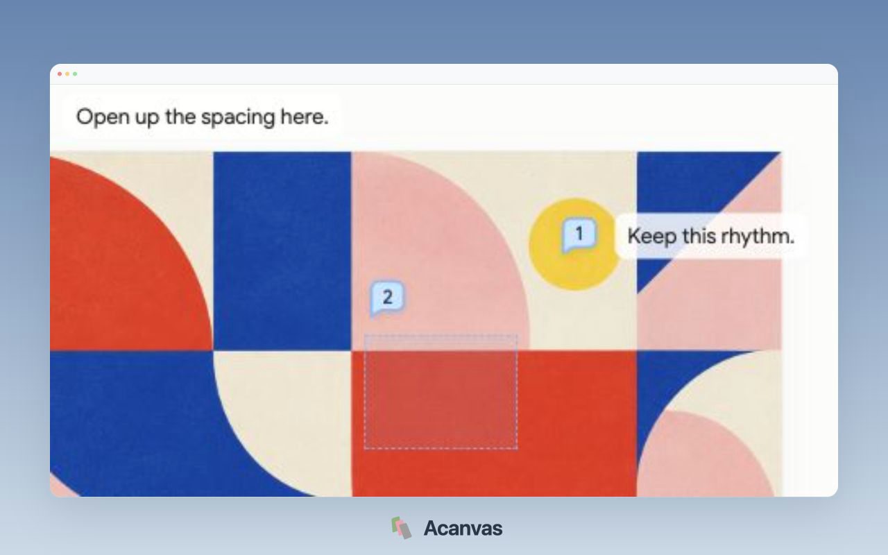
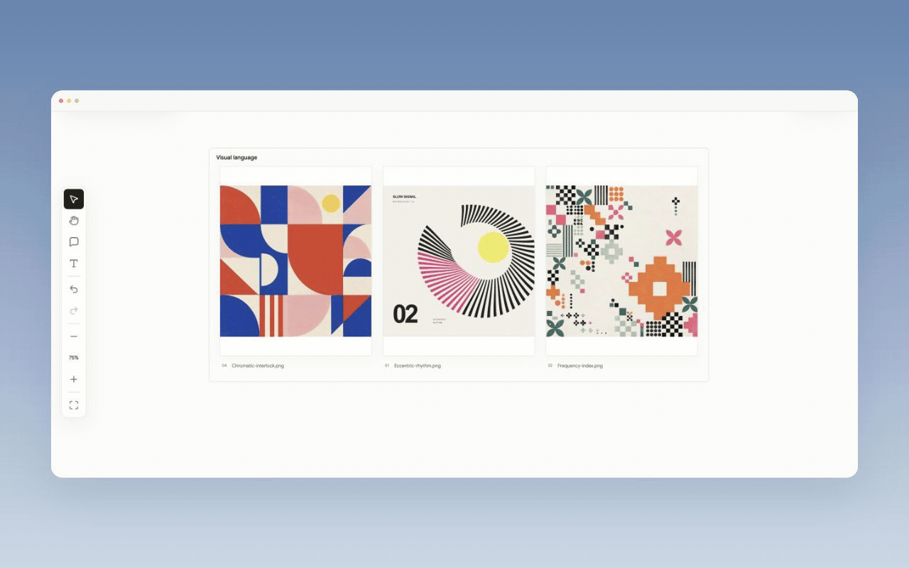
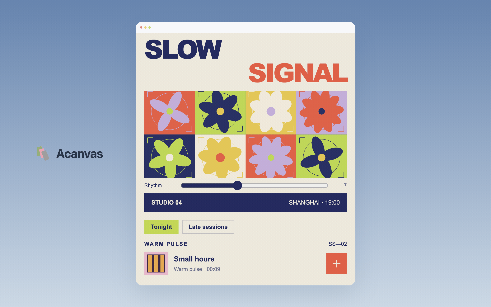
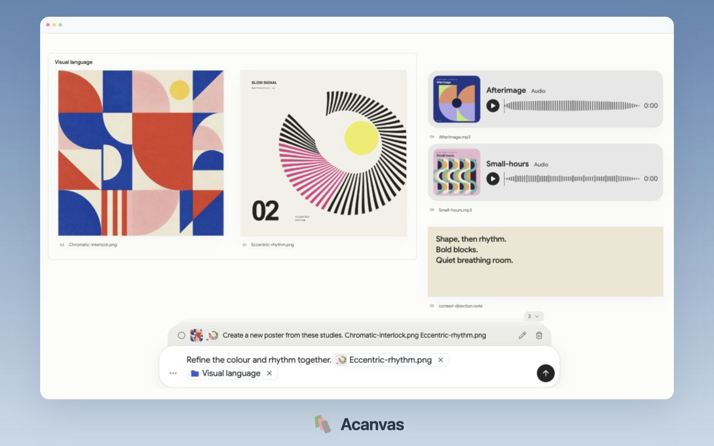

<h1 align="center"> Acanvas</h1>
<p align="center"><strong>canvas for agent-ready harnesses</strong><br>A shared visual workspace for references, instructions, and creative results.</p>

<p align="center">
  <a href="package.json"></a>
  <a href="https://code.claude.com/docs/en/skills"></a>
  <a href="https://agentskills.io"></a>
  <a href="LICENSE"></a>
  <a href="#requirements"></a>
</p>
<p align="center">
  <a href="https://github.com/Flyx7Kazami/acanvas/archive/refs/heads/master.zip"></a>
  &nbsp;
  <a href="#install"></a>
</p>
<p align="center"><strong>English</strong> · <a href="README.zh-CN.md">简体中文</a></p>
<p align="center">
  <a href="#quick-start">Quick start</a> · <a href="#showcase">Showcase</a> · <a href="#core-features">Features</a> · <a href="#install">Install</a> · <a href="#usage">Usage</a> · <a href="#how-it-works">How it works</a> · <a href="#contact">Contact</a>
</p>

Bring references, mark what matters, and keep new drafts beside the ideas that shaped them. You set the direction; your agent does the making with its own models and creative tools.

> **Under active development.** Database schemas and internal formats are still evolving, and backward compatibility across versions is not guaranteed. Fork the repository for custom development.

## Quick start 

Install the Skill for Codex in your current project:

```sh
npx skills add Flyx7Kazami/acanvas --skill acanvas -a codex
```

Then ask your agent:

```text
Use Acanvas to open a canvas for this project.
```

On first use, Acanvas prepares Node.js 24, its dependencies, and the local application inside the Skill installation. Open the returned whiteboard URL to start adding references. Your global Node configuration stays with your existing environment.

## Showcase 


<table>
  <tr>
    <td width="50%" align="center" valign="top">
      <a href="assets/readme/details/annotation.png"></a><br>
      <strong>Point to the exact change.</strong>
    </td>
    <td width="50%" align="center" valign="top">
      <a href="assets/readme/details/folders.gif"></a><br>
      <strong>Group, fold, and explore.</strong>
    </td>
  </tr>
  <tr>
    <td width="50%" align="center" valign="top">
      <a href="assets/readme/details/html.gif"></a><br>
      <strong>Interact with HTML in place.</strong>
    </td>
    <td width="50%" align="center" valign="top">
      <a href="assets/readme/details/context.png"></a><br>
      <strong>Keep every request in context.</strong>
    </td>
  </tr>
</table>

## Core features 

- **Multimodal, multi-format canvas.** Combine images, GIFs, video, audio, notes, Markdown, and interactive HTML in one workspace.
- **Visual instructions.** Reference items or groups, mark points and regions, and attach precise feedback to a request.
- **Iteration in place.** Bring agent outputs back beside their references. Compare directions, organize groups and folders, and undo or redo board edits.
- **A canvas for your existing agent.** Use the bundled Skill and CLI with an agent that can run local tools. Boards and original files stay in your project; requests and history stay with their task context.

## Use cases 

- **Visual creation.** Turn references and a brief into posters, page concepts, or interactive prototypes with your agent. You choose the aesthetic direction; your agent does the making. Compare outputs and refine them on the canvas.
- **Visual idea coworking and collection.** Use your agent’s search tools to collect inspiration, then gather references and notes into a shared moodboard. Group themes, explore alternatives together, and develop promising ideas into a clear direction.
- **More intuitive human–agent interaction.** Select an item, mark a region, or reference a group to say “make this warmer” or “combine these two.” Keep the visual context with each request and review the result in the same workspace.

## Install 

This repository is a standard Agent Skill: [SKILL.md](SKILL.md) is its root entry, with executable helpers and references included.

| Scope | Command |
| --- | --- |
| Current project, Codex | `npx skills add Flyx7Kazami/acanvas --skill acanvas -a codex` |
| Your user, Codex | `npx skills add Flyx7Kazami/acanvas --skill acanvas -g -a codex` |
| Your user, Claude Code | `npx skills add Flyx7Kazami/acanvas --skill acanvas -g -a claude-code` |
| Your user, OpenCode | `npx skills add Flyx7Kazami/acanvas --skill acanvas -g -a opencode` |

Leave out `-a` to choose agents interactively. Private repositories use your normal Git or GitHub authentication.

Bring your preferred agent: Codex, Claude Code, Cursor, GitHub Copilot, Gemini CLI, OpenCode, Cline, Devin Desktop (Windsurf), Google Antigravity, Kiro, TRAE, Qwen Code, Kimi Code, OpenHands, Amp, Factory Droid, Goose, Pi, OpenClaw, Mistral Vibe, or your own harness. It needs permission to read the Skill, run local commands, and access the project and its service.

<details>
<summary>Download without Git</summary>

[Download the ZIP](https://github.com/Flyx7Kazami/acanvas/archive/refs/heads/master.zip), unpack it, and rename the extracted folder to `acanvas`. Place it in `~/.agents/skills/` for Codex or `~/.claude/skills/` for Claude Code, with `SKILL.md` directly inside the `acanvas` folder.

</details>

<details>
<summary>Build and run from source</summary>

With Node.js 24:

```sh
git clone https://github.com/Flyx7Kazami/acanvas.git
cd acanvas
npm install
npm run build
node scripts/acanvas.mjs project open --project "$PWD"
```

Open the `openUrl` printed by the CLI. The service continues running after the launcher exits.

</details>

## Usage 

1. Add materials to the canvas and arrange them into a working context.
2. Select references, annotate a point or region, and send a request.
3. Choose **Copy resume prompt** from the composer’s **⋯** menu and paste it into your agent. Or, if your agent already has this canvas’s context, simply send **“continue”** to pick up queued requests automatically. Results return to the same canvas for the next iteration.

Try a concrete request:

```text
Collect references for an independent image-and-sound gathering.
Explore three visual directions and place the results beside them.
```

```text
Use this group as the direction for an interactive landing page.
Keep the grain, soften the typography, and add a short sonic sketch.
```

HTML previews and annotation snapshots run in your browser. The [usage guide](references/usage.md) covers service controls, media behavior, and advanced setup; the [workflow guide](references/workflow.md) covers CLI operations and saved queues.

## How it works 

The Skill tells your agent how to read visual context and use the shared CLI. The local application stores project materials and scoped requests, serves the canvas, and publishes changes through the same business interface used by the UI.

```text
SKILL.md       Skill entry and essential workflow
scripts/       CLI, setup, and development helpers
references/    Operating guides loaded when needed
app/           Application source, tests, and native support
assets/        Brand and showcase materials
```

## Requirements 

| Requirement | Used for |
| --- | --- |
| An agent with local file and command access | Reading the Skill and carrying out requests |
| npm and network access during initial setup; Git for the skills CLI | Installing the Skill and preparing dependencies |
| Node.js 22.20+ on your host (24 recommended) | Running the `npx skills` installer |
| Node.js 24 | Application runtime; prepared locally on first use |
| A browser | Viewing and interacting with the canvas; media playback follows its codec support |

Host binding selects the task scope. Automatic delivery requires a separately attached compatible runtime; ordinary use continues through the saved queue and resume prompt. Optional native rendering and further platform details are in the usage guide.

## Contact 

Questions, ideas, or feedback: [open an issue](https://github.com/Flyx7Kazami/acanvas/issues) or email [yingbowu.yw@gmail.com](mailto:yingbowu.yw@gmail.com).

## Support 

Help Acanvas grow: star the repository, share what you make, report issues, or contribute improvements.

## License 

[MIT](LICENSE) © 2026 Flyx7Kazami. Free to use, modify, distribute, and use commercially, including in closed-source products, with the copyright and license notice preserved. Third-party dependencies and assets retain their own licenses.

## Star History 

<a href="https://www.star-history.com/?repos=Flyx7Kazami%2FAcanvas&type=date&legend=top-left">
  <picture>
    <source media="(prefers-color-scheme: dark)" srcset="https://api.star-history.com/chart?repos=Flyx7Kazami/Acanvas&type=date&legend=top-left&theme=dark">
    
  </picture>
</a>
