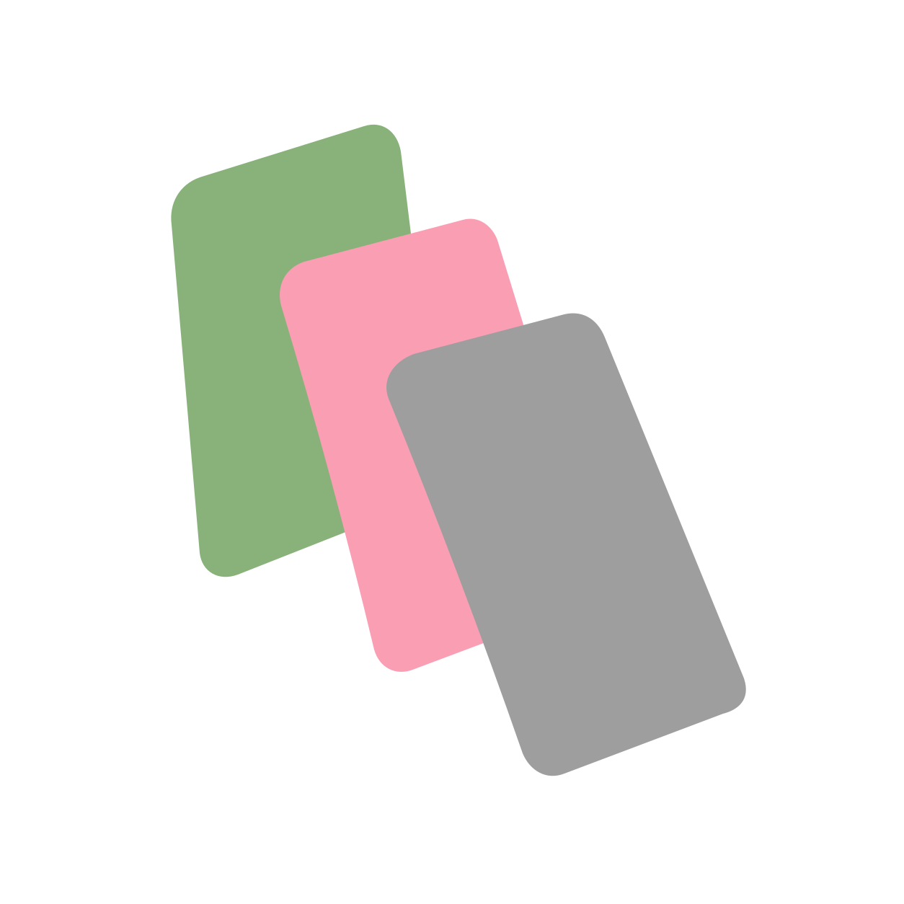
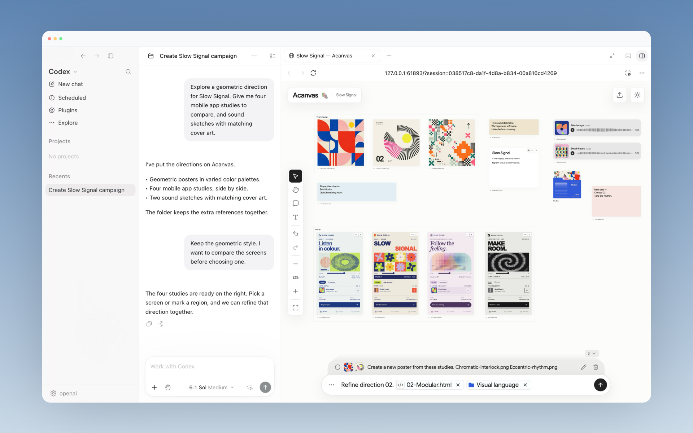

<h1 align="center"> Acanvas</h1>
<p align="center"><strong>canvas for agent-ready harnesses</strong><br>把参考、指令和创作结果放进你与 agent 的共享视觉工作区。</p>

<p align="center">
  <a href="package.json"></a>
  <a href="https://code.claude.com/docs/en/skills"></a>
  <a href="https://agentskills.io"></a>
  <a href="LICENSE"></a>
  <a href="#运行要求"></a>
</p>
<p align="center">
  <a href="https://github.com/Flyx7Kazami/acanvas/archive/refs/heads/master.zip"></a>
  &nbsp;
  <a href="#安装"></a>
</p>
<p align="center"><a href="README.md">English</a> · <strong>简体中文</strong></p>
<p align="center">
  <a href="#快速开始">快速开始</a> · <a href="#效果展示">效果展示</a> · <a href="#核心功能">核心功能</a> · <a href="#安装">安装</a> · <a href="#使用">使用</a> · <a href="#工作方式">工作方式</a> · <a href="#联系方式">联系方式</a>
</p>

带上参考、标记重点，把新产物放在它的创作上下文旁边。你把握方向与质量，agent 使用已有的模型和工具完成具体制作。

> **积极开发中。** 数据库结构及内部格式仍在演进，暂不保证跨版本兼容。建议二次开发先 fork 仓库。

## 快速开始 

为当前项目的 Codex 安装 Skill：

```sh
npx skills add Flyx7Kazami/acanvas --skill acanvas -a codex
```

然后告诉 agent：

```text
使用 Acanvas，为这个项目打开一个画布。
```

首次使用时，Acanvas 在 Skill 安装目录准备 Node.js 24、依赖和本地应用。打开返回的白板 URL，即可开始添加参考。全局 Node 配置沿用你现有的环境。

## 效果展示 



## 核心功能 

- **多模态、多格式画布。** 将图片、GIF、视频、音频、便笺、Markdown 和可交互 HTML 放进同一工作区。
- **可视化指令。** 引用素材或分组，标记点位和区域，把具体反馈加入创作请求。
- **原位迭代。** 将 agent 产物放回参考旁边，比较不同方向，用分组和文件夹组织内容，支持白板编辑的撤销与重做。
- **连接已有的 agent。** 通过内置 Skill 和 CLI，与能够执行本地工具的智能体协作。白板和原始文件归项目保存，请求和历史跟随对应的任务上下文。

## 应用场景 

- **视觉创作。** 把参考和创作要求交给 agent，制作海报、页面概念或交互原型。你把握审美方向，agent 完成具体制作；在画布上比较产物并持续调整。
- **视觉 idea 共创与搜集。** 借助 agent 的搜索工具搜集灵感，把参考和笔记汇成共享情绪板。整理主题、一起发散方案，再把有潜力的想法深化为明确方向。
- **更直观的人机交互。** 选中素材、标记区域或引用分组，用“这里暖一点”“把这两个方向结合起来”表达反馈。每个请求保留对应的视觉上下文，结果也回到同一工作区中查看。

## 安装 

仓库本身就是标准 Agent Skill：[SKILL.md](SKILL.md) 是根入口，随附执行脚本与操作参考。

| 范围 | 命令 |
| --- | --- |
| 当前项目，Codex | `npx skills add Flyx7Kazami/acanvas --skill acanvas -a codex` |
| 当前用户，Codex | `npx skills add Flyx7Kazami/acanvas --skill acanvas -g -a codex` |
| 当前用户，Claude Code | `npx skills add Flyx7Kazami/acanvas --skill acanvas -g -a claude-code` |
| 当前用户，OpenCode | `npx skills add Flyx7Kazami/acanvas --skill acanvas -g -a opencode` |

省略 `-a` 可交互选择 agent。私有仓库使用你已有的 Git 或 GitHub 身份验证。

搭配你常用的 agent：Codex, Claude Code, Cursor, GitHub Copilot, Gemini CLI, OpenCode, Cline, Devin Desktop (Windsurf), Google Antigravity, Kiro, TRAE, Qwen Code, Kimi Code, OpenHands, Amp, Factory Droid, Goose, Pi, OpenClaw, Mistral Vibe，或自己的 harness。它需要具备读取 Skill、执行本地命令以及访问项目文件和服务的权限。

<details>
<summary>直接下载</summary>

[下载 ZIP](https://github.com/Flyx7Kazami/acanvas/archive/refs/heads/master.zip)，解压并将文件夹重命名为 `acanvas`。Codex 用户将其放入 `~/.agents/skills/`，Claude Code 用户放入 `~/.claude/skills/`；`SKILL.md` 位于 `acanvas` 文件夹的根目录。

</details>

<details>
<summary>从源码构建与运行</summary>

在 Node.js 24 环境中：

```sh
git clone https://github.com/Flyx7Kazami/acanvas.git
cd acanvas
npm install
npm run build
node scripts/acanvas.mjs project open --project "$PWD"
```

打开 CLI 输出的 `openUrl`。服务在启动命令退出后继续运行。

</details>

## 使用 

1. 将素材加入画布，整理成创作上下文。
2. 选择参考，标记点位或区域，再发送请求。
3. 从输入框的 **⋯** 菜单选择 **Copy resume prompt**，粘贴给 agent 接续。如果 agent 已有此画布的上下文，也可以直接发送 **“继续”** 或 **“continue”**，自动接续队列请求。结果回到同一画布，继续下一轮迭代。

可以从具体请求开始：

```text
为一场独立影像与声音活动搜集参考。
探索三个视觉方向，把结果放在参考旁边。
```

```text
以这个分组作为交互式活动页的视觉方向。
保留颗粒感，柔化文字排版，再做一段声音草稿。
```

HTML 预览与批注截图在浏览器中完成。[使用指南](references/usage.md)包含服务管理、媒体行为和进阶设置；[工作流指南](references/workflow.md)包含 CLI 操作与保存队列的接续方式。

## 工作方式 

Skill 告诉 agent 如何读取视觉上下文与调用共享 CLI。本地应用保存项目素材与对应任务的请求、提供白板，并通过与界面相同的业务接口发布变更。

```text
SKILL.md       Skill 入口与核心工作流程
scripts/       CLI、环境准备与开发脚本
references/    按需读取的操作指南
app/           应用源码、测试与原生支持
assets/        品牌与效果展示素材
```

## 运行要求 

| 要求 | 用途 |
| --- | --- |
| 具备本地文件与命令权限的 agent | 读取 Skill、执行请求 |
| 首次设置时可用的 npm 与网络；skills CLI 另需 Git | 安装 Skill、准备依赖 |
| 宿主 Node.js 22.20+（推荐 24） | 执行 `npx skills` 安装器 |
| Node.js 24 | 应用运行时，首次使用时在本地准备 |
| 浏览器 | 查看与操作画布；媒体播放取决于其格式支持 |

宿主绑定用于选择任务范围。自动投递需要单独连接兼容的 runtime；常规使用通过保存队列和接续口令继续。可选原生渲染与其他平台细节见使用指南。

## 联系方式 

问题、想法和反馈可以提交到 [Issues](https://github.com/Flyx7Kazami/acanvas/issues)，或发送邮件至 [yingbowu.yw@gmail.com](mailto:yingbowu.yw@gmail.com)。

## 支持项目 

欢迎 Star 项目、分享创作成果、反馈问题或贡献改进。

## 开源协议 

[MIT](LICENSE) © 2026 Flyx7Kazami。保留版权声明和许可证后，可自由使用、修改、分发和商用，也可用于闭源产品。第三方依赖和素材沿用各自的许可证。

## Star History 

<a href="https://www.star-history.com/?repos=Flyx7Kazami%2FAcanvas&type=date&legend=top-left">
  <picture>
    <source media="(prefers-color-scheme: dark)" srcset="https://api.star-history.com/chart?repos=Flyx7Kazami/Acanvas&type=date&legend=top-left&theme=dark">
    
  </picture>
</a>
