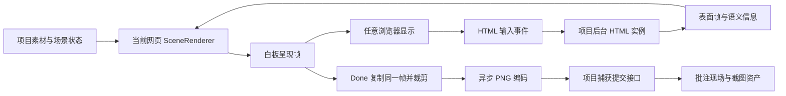

# 任意浏览器中的后台截图技术方案

日期：2026-10-09（Asia/Shanghai）。状态：技术设计与当前源码核对完成，独立设计审查 PASS；当前范围实现、独立验收与正式服务更新完成，实际支持和测量边界见[实施记录](UNIVERSAL_BACKGROUND_CAPTURE_IMPLEMENTATION.md)。关联 R02、R04、R05、R13 / A02、A06、A07、A09。依据用户要求：acanvas 网页在任意支持的浏览器或 agent 容器中打开，完成批注后自动保存截图，使用当前页面继续工作。

## 1. 产品目标与成立范围

截图对象是用户所见的 acanvas 白板内容、批注标记及周围材料。网页壳层可以运行在 Chrome、Edge、Firefox、Safari、Codex 内置浏览器及其他能正常运行 acanvas 的现代 WebView 中。客户端能访问项目服务，并具备标准 JavaScript、Canvas、图像解码和网络 API；截图入口与 agent 产品、对话宿主及浏览器品牌无关。

正常操作只有“标记 → 评论 → Done”。Done 取出白板已呈现的画面，自动编码、上传和保存，完成后展示缩略图。项目服务初始化所需后台运行器；用户继续停留当前页面。短暂故障自动恢复，恢复使用本次已取出的画面。真实失败保留评论与位置，并提供明确恢复状态。Send 的完整证据检查继续由本地服务执行。

“所见一致”定义为同一个应用呈现帧的内容和坐标一致：保存用于显示的白板像素及其场景元数据。浏览器对 CSS 缩放的采样、操作系统色彩管理与显示器输出属于显示设备边界；证据记录实际图像尺寸和应用坐标映射。

本方案属于白板呈现架构调整。新实现将当前网页的可导出呈现帧接入默认 Done；正式运行更新在完整候选独立验收后执行。既有受控 Chrome 路径的事实保留在[完整交互设计](CHATBOX_IMPLEMENTATION_DESIGN.md)，新路径按本方案及实施记录验收。

## 2. 方案开始时的差距与技术依据

方案开始时，[ProjectBrowser](../../src/server/browser-capture.ts) 默认启动可见 Chrome，并在打开页面时调用 `bringToFront()`；provider 只注入其创建的 Page。此前 App 的 Done 遇到缺少 provider 会要求打开截图窗口。既有协议保存坐标、视口和场景参考元数据，真实 PNG 来自该受控 Page；当前实施将默认捕获接入原网页的已呈现 Canvas。

普通网页的屏幕捕获要求用户选择来源、瞬时交互和授权，授权不能永久保存，因此适合作为显式共享能力。[W3C Screen Capture](https://www.w3.org/TR/screen-capture/#dom-mediadevices-getdisplaymedia)

Canvas 可以导出应用自身持有的像素，跨源污染的 canvas 会拒绝导出。对动画图片直接 `drawImage(img)` 得到默认图或首帧；将浏览器正在播放的 GIF 当成可导出的当前帧会产生错误。[HTML Canvas 标准](https://html.spec.whatwg.org/multipage/canvas.html#security-with-canvas-elements)、[图像来源规则](https://html.spec.whatwg.org/multipage/canvas.html#image-sources-for-2d-rendering-contexts)

现有 [HTML snapshot](../../src/shared/html-preview-snapshot.ts)采用 DOM/样式序列化与 SVG 复现，排除部分嵌入节点。随机状态、绘画、任意 JavaScript 堆和 WebGL 运行画面无法靠重新加载同一 HTML 文件通用还原。

后台 headless 渲染器可以运行完整浏览器而保持无可见窗口。[Chrome Headless](https://developer.chrome.com/docs/automation-and-testing/headless) 项目可以使用声明、安装和验证过的渲染引擎；Chromium 是内部运行依赖，用户浏览器继续独立选择。现有安装 Google Chrome 的前提由项目管理的引擎分发与格式验证取代。

### 2.1 当前 Codex 源码的实际实现

2026-10-09 重新只读核对当前安装 `/Applications/ChatGPT.app`：bundle identifier `com.openai.codex`，版本 `26.1002.52244`、build `13536`。关键源码重新从 ASAR 读取，事实与 UTF-16 位置见[当前源码核对](../evidence/universal-capture/codex-source-refresh.json)。

保存型批注链路如下：

1. 评论弹窗发送 `browser-sidebar-comment-overlay-submit`，preload 经 IPC 进入主进程 `handleCommentOverlaySubmit → handleOverlaySubmit`。
2. 主进程写 `snapshot.comments`，关闭评论编辑浮层并同步，然后调用 `captureSavedCommentScreenshot`。
3. 原页面 preload 接收 `prepare-comment-screenshot(commentId)`，显示对应标记，等待一次 `requestAnimationFrame` 后回报当前矩形与标记位置。
4. 主进程从该线程原页的 `page.view.webContents` 取得对象，确认就绪后执行源码中的 `await e.capturePage()`，参数为空。
5. 得到 NativeImage 后按截图范围选择裁剪、按大小等比缩放及 `toDataURL()`，回填对应评论的 `screenshot` 并同步。
6. 后续发送聊天时，消息编排读取评论截图，再把说明文字与图片加入 turn input；保存评论与发送消息是两个时点。

Codex 截取的是它的 Electron 程序已经承载的同一个页面，其原生进程拥有这个页面对象。它使用内置浏览器引擎，截图调用发生在原生主进程中。网页 JavaScript 没有因此获得 `webContents` 权限，外部浏览器也不会自动得到该接口。

这一实现可借鉴“持有真实画面来源、保存评论后自动取图、图片与评论关联”。acanvas 的跨浏览器路径把来源改为应用自己可导出的白板呈现帧；动态 HTML 仍由项目持有持续运行的实例。当前 Codex 源码核对没有进行截图测量，页面隐藏/最小化及后台媒体节流的运行效果按单独实测声明。

## 3. 推荐架构：白板画面自身可导出

采用“客户端统一可导出渲染层 + 项目持有动态 HTML 表面”。普通素材在用户当前页面中渲染为白板像素；任意允许的动态 HTML 在项目后台的持续实例中运行，页面显示该实例送出的像素。所有进入截图的内容最终都出现在同一个可导出白板画面中。



### 3.1 SceneRenderer

把图片、文件卡片、Markdown 内容、视频画面、GIF、音频波形、媒体选区和批注标记的可见内容迁入统一渲染层。显示与截图共享素材纹理、文本布局、图层、裁剪、颜色和坐标计算。聊天、菜单、评论编辑框和工具栏保留原生 React/DOM 交互，位于证据画面之外。

基础实现采用浏览器 Canvas 2D 和可复制的图像帧。支持的环境使用 worker/OffscreenCanvas 进行绘制或编码；其他目标环境使用普通 Canvas 的异步导出。两个实现采用同一呈现模型与验收语义。[OffscreenCanvas 编码接口](https://developer.mozilla.org/en-US/docs/Web/API/OffscreenCanvas/convertToBlob)

用户完成批注时，同步把当前白板 bitmap 复制到独立证据画面，再异步编码。异步过程中白板可以继续变化，证据持有独立像素。`frameSeq` 关联这份像素、实际相机、图层和媒体信息；复制过程与渲染帧提交在同一串行操作边界执行。

worker 只产生候选帧及与其成对的 `ScenePresentation`。主线程接收不可变像素和元数据，在提交该帧到可见 Canvas 时一起更新 `presentedFrame`；Done 从这份主线程记录同步复制。worker 已生成但尚未提交的帧属于候选队列。使用 OffscreenCanvas 的实现也通过明确的 ImageBitmap/帧交接更新可见画面，保持像素与元数据成对，而不从 worker 最新状态推断显示内容。

显示画面本身必须来自该渲染层。保留另一套 DOM 作为可见白板、仅在 Done 后重新画一次 Canvas，只能得到复现图，达不到本方案的所见一致目标。

### 3.2 素材与可导出性

| 类型 | 显示与证据来源 | 需要完成的工作 |
| --- | --- | --- |
| 图片、普通文件 | 同一个已解码纹理及项目绘制的卡片 | 使用授权资产字节；保持布局、裁剪、圆角和层序。 |
| Markdown | 共享文本布局与绘制结果 | 建立文本 run 与原文偏移、链接、引用、滚动及选择的对应关系。语义 DOM/选择操作和绘制布局相同。 |
| 音频 | 现有完整波形数据与当前已绘制进度 | 原生音频播放保留用户手势；证据记录实际呈现进度，区分用户选择区间。 |
| 视频 | 明确时间戳的已解码视频帧 | 显示和证据使用同一帧；能力可用时采用 WebCodecs，其他目标使用项目声明的解码实现。音频输出与视频呈现时钟同步。 |
| GIF | 项目管理的解码帧与帧序号 | 替换直接 `` 播放路径；可用 API 与 JS/WASM 解码实现共同覆盖目标环境。 |
| HTML、其 canvas/WebGL/动画 | 后台同一持续执行实例产出的表面帧 | 页面展示该帧，完成批注使用已显示的帧；后台实例处理交互和内部状态。 |

所有纹理通过项目授权资产/表面接口取得，保持 canvas 可导出。导入参考内容继续使用原始文件和受控 bundle 映射；资源格式、解码、字体和着色器能力按实际样本验证。素材无法正常呈现时，应用记录呈现错误，捕获流程保持其实际状态。

### 3.3 HTML 持续表面

任意允许脚本的 HTML 从前端独立 iframe 执行改为项目服务持有的持续实例。该实例保留实际表单、DOM、滚动、随机结果、canvas/WebGL 与动画状态。客户端只接收表面像素及必要的语义信息，指针、滚轮、键盘、焦点和输入法操作通过项目协议送回该实例。

每个 HTML 实例按 `project/session/view/object` 归属。相同会话的两个网页可以有不同内部状态；实例身份表达客户端视图，agent 身份继续独立。表面帧带 `surfaceId/frameSeq/instanceId`、实际像素尺寸、内容 viewport、服务已接受输入序号与语义快照关联。成功及失败的已接受输入都取得序号回执；配对候选另外表达实际呈现状态。

客户端记录实际合入白板的 HTML 帧身份。截图保存这份像素，后台 HTML 即使已推进到后续动画帧，也不会改写证据。后台实例按需采样帧供展示；Done 使用既有表面像素，继续使用原实例。

输入坐标先反算白板相机，再根据显示的表面尺寸映射到实例 CSS 坐标。输入带对应表面身份与 viewport；尺寸改变时明确处理旧坐标。IME 用本地真实输入控件承接组合并传递组成/提交操作。语义层提供焦点、阅读顺序、链接、表单与文本选择，密码等敏感输入遵循其原有显示与语义边界。

现有 HTML 的独立 origin、opaque sandbox、CSP、bundle 资源范围和关闭的宿主权限继续保留。后台页面中仍按现有隔离模型承载 HTML；浏览器调试和任意 JavaScript 执行接口留在服务内部。远程表面的键盘/IME、文字选择、可访问性与延迟是该方案必须通过的独立验收项。

HTML 当前允许的交互需要逐项迁移：文本/contenteditable 和组合输入、select/date/color 的值及原生弹层、文件选择、选区/复制、剪贴板入口和焦点。浏览器原生控件由前端语义控件承接，提交明确的值与事件到指定 HTML 实例，交互状态回到同一表面帧。文件入口保留当前页面的用户选择，将已选择字节送入受控实例，服务使用该字节，不接收客户端机器路径。原有关闭的剪贴板等权限继续关闭；用户发起的复制/粘贴按客户端权限和选区语义处理。

源脚本通过合法 `showPicker()` 打开的 renderer PagePopup 属于引擎表面。主表面最新 visual commit 完成后，原生运行器在新绘制回调中成对取得弹层像素与 root-view CSS 位置，按实际位图比例合成，保留该候选的弹层元数据。前端以已呈现弹层区域优先路由实际指针坐标，公开 CEF 主机输入接口交给正确原生 widget。关闭弹层的后续候选恢复普通语义控件命中；旧 N 的像素和位置保持原样。

HTML 内允许的 WebAudio 发声若进入交付范围，声音回传当前客户端，并由本地用户手势启用；后台实例保持静音输出到传输管道。音频时间、可见表面帧和客户端播放时间一起测量。任意实例的声音不能在后台机器直接播放。P1 原型允许仅测视觉；P2 必须验证现有允许的发声及上述控件，明确逐类型支持结果，之后才进入完整 HTML 产品验收。

因此后台表面运行器的接口需要包含像素、语义与带时间戳的音频输出。现有 Playwright screenshot 可以承担 P1 视觉原型；它本身不提供完整 HTML 音频输出路径。CEF 的原生 `CefAudioHandler` 提供 PCM packet 和呈现时间戳，可作为音频表面运行器的候选接口，具体分发、静音输出和客户端播放在 P2 原型验证。[CEF 音频接口](https://cef-builds.spotifycdn.com/docs/139.0/classCefAudioHandler.html) 截图可行性与完整 HTML 交互能力分别取得实测，选定引擎后再声明生产支持。

## 4. 呈现帧与捕获数据

新增的呈现记录使用普通 ID、序号和类型字段，示意如下。接口细节由原型事实收敛，不冻结协议。

```ts
interface ScenePresentation {
  documentId: string;
  viewId: string;
  frameSeq: number;
  baseSceneId: string;
  camera: { x: number; y: number; zoom: number };
  cssViewport: { x: number; y: number; width: number; height: number };
  bitmap: { width: number; height: number };
  layers: RenderedLayer[];
  media: PresentedMedia[];
}

interface EvidenceFrame {
  identity: BrowserCaptureIdentity;
  presentation: ScenePresentation;
  target: AnnotationTarget;
  cropCSS: Bounds;
  sourceMode: 'scene-bitmap';
  png: Blob;
}
```

`RenderedLayer` 保存对象/资产身份、服务确认的基础版本、实际绘制范围、裁剪、层序与适用的表面帧。`PresentedMedia` 分别表达用户选择的时间/区间、所呈现媒体帧时间、代表帧时间及保存时间。布局、命中、原文锚点与截图由同一呈现记录关联。

普通 `frameSeq` 解决具体失败场景：用户看到 N，编码或网络期间动画已经变成 N+5。序号关联已取出的像素与元数据；捕获保存 N。任何局部 CSS 预览变换必须进入呈现记录和截图组合，或者在 Done 前成为已提交白板像素。命中测试使用用户实际看到的变换。

当前 [captureScene](../../src/web/annotation-scene.ts)的 64 对象参考集合是有界证据元数据。完整渲染输入与该参考集合分开；可见对象超过该数量时，白板像素继续包含全部可见内容，参考元数据沿用省略数量说明和当前资源边界。

## 5. Done、保存与自动恢复

1. 用户 Done：保留当前应用呈现帧与目标，复制并裁剪证据像素，保留评论。
2. 保存草稿与来源：提交当前目标及所关联的 `viewId/baseSceneId/frameSeq` 来源上下文。服务从已交付的基础快照解析目标和资产，在同一草稿保存事务中建立受任务范围约束的来源记录并分配批注版本；目标或会话变化使旧工作失效。
3. 编码/上传：异步编码 PNG，使用现有捕获身份上传。当前页默认接入项目 provider，能力初始化属于应用启动过程。
4. 提交：服务检查版本、来源、场景与图片，完成 `prepared → committed`，回填完整草稿。
5. 完成：顶部摘要展示正式缩略图，Send 使用相同服务完整性检查。

失败恢复针对同一份已取出的像素。编码、传输或结果响应丢失时，执行有界自动恢复并查询已提交结果；界面保留保存状态。服务持久取得完整图像后，页面刷新、渲染器断开及服务重启按既有结果恢复。像素仅存于页面内存且页面退出时，原始瞬态现场可能丢失；可用的浏览器存储为未上传任务保留有界 Blob，存储失败保持明确未完成状态。

用户重新选择目标、媒体位置或明确重拍时取得新的呈现帧和捕获版本。评论文字编辑继续沿用已保存现场。正常入口收为 Done，重试按钮服务于实际失败恢复。

## 6. 服务侧一致性与证据归属

复用现有会话/草稿/批注/版本身份、结果查询、PNG 结构和尺寸检查、文件落盘、短事务、证据资产归属、取消失效及 Send 检查。[捕获基础](CAPTURE_FOUNDATION_DESIGN.md)继续作为持久提交依据。

现 [saveDraft/validateAnnotation 与 prepareCapture](../../src/server/service.ts)会检查当前对象，可能在 PNG 预备之前就拒绝用户已看到旧帧、随后被其他会话移动/删除对象的场景。新路径从首次草稿保存开始采用服务曾提供给该 view 的场景快照作为基础事实：服务生成 `baseSceneId`，关联实际交付的对象版本与授权资产；呈现确认和捕获意图按 view 的操作次序处理，在草稿保存/捕获任务中保留相应基础快照。

捕获仍检查当前批注版本/目标以及基础快照归属。客户端的临时绘制范围作为受约束的视图输入保存；基础对象/资产来自服务确认记录。服务生成的 HTML 表面帧另校验实例与 view 归属。这样保留正确的历史现场，并保持现有身份、类型、范围和资源校验。客户端像素路径沿用当前可信项目客户端的权限模型，来源明确标记为 `scene-bitmap`。

同一来源记录用于首次 `validateAnnotation`、后续草稿读取/保存、PNG 预备与 Send 的批注验证；完成 PNG 后由已有完整 capture 继续提供事实。来源记录只接受服务确认的快照及其归属，客户端直接提交任意历史对象仍会拒绝。改变目标使用新的来源和版本。用户显式 `@` 引用继续按其自身发送规则解析，批注现场不自动改变显式引用的对象存续条件。

多个网页打开相同 session 时，聊天/队列范围继续为 session，显示与捕获现场按 document/view 独立。局部 view 操作序号、普通主键和有界快照保留解决乱序和旧现场引用；渲染器及场景快照生命周期由服务管理。

## 7. 运行、资源与交互成本

项目管理后台引擎和解码依赖，运行配置通过项目声明；客户端浏览器品牌和 agent 运行时不参与选择。后台引擎使用 headless 模式、独立项目配置与现有系统沙箱，所有访问限定授权资源和项目接口。页面启动自动取得所需表面；生命周期随实例使用和已完成证据管理。

活跃表面在连接或运行实例失效时持续重连，重连间隔采用有上限的退避，每步有超时，关闭及明确停止结束重连。截图工作的编码／上传采用有限次数恢复，继续沿用同一份已复制像素。表面连接生命周期与单次证据工作的重试范围分别管理。

动态 HTML 需要持续执行、采样、编码、传输与解码；相较当前本地 iframe 会增加成本和输入时延。静态表面按变化发布，动态表面有界发送，客户端只合成需要显示的帧。前台线程复制证据像素也有开销，worker 编码属于优化路径，普通 Canvas 异步编码需要实测大图响应。

资源限制使用并发数、像素数、字节数、时间和有界队列。1440×1000 RGBA 的单帧约 5.76 MB，DPR2 约 23.04 MB；副本、解码器和后台实例另外计量。当前 PNG/解码和预览资源限制作为初始依据，参数按原型测量调整。实例回收/崩溃会丢失任意 JS 运行态，保留的帧与已完成证据继续可读，交互实例重新启动的实际状态明确呈现。

## 8. 分阶段实施与验收

| 阶段 | 交付 | 必须取得的实测 |
| --- | --- | --- |
| P1 隔离原型 | 同一可见 Canvas 导出；一个后台 HTML 持续表面 | 两种不同引擎普通网页和实际内置浏览器保持原页面；动态表单/随机 canvas/WebGL 帧一致；无开窗口和焦点跳转。 |
| P2 渲染层 | 图片/文件/Markdown/波形、视频和 GIF 的可导出呈现；HTML 语义与输入 | 各目标浏览器首帧、非首帧、原文/选择/滚动、播放与声音、HTML WebAudio/原生控件/文件/复制、键盘/触屏/IME、可访问性；只在 PNG 使用与显示相同像素后计通过。 |
| P3 提交与恢复 | 默认项目 provider、场景快照归属、有界自动恢复 | 并发对象更新、同会话双网页、响应丢失、上传取消、刷新/重启、旧任务与 CLI；完整文件持久后恢复原证据。 |
| P4 完整产品入口 | 全素材与跨环境默认流程 | Chrome、Edge、Firefox、Safari、实际内置浏览器/WebView 分别完成 Done→缩略图→Send，全链路无手动窗口操作。 |

各阶段覆盖点/区域、DPR1/2、页面与画布缩放、resize、320px、部分出屏、明暗主题、可见对象超过 64；输入、呈现、编码及上传延迟和 CPU/RAM 记录 p50/p95。性能目标在原型取得冷/热态、动态与多视图测量后确定。任何环境未实测时，记录为待验收。

关键反例测试：

- 用户呈现 N，后台 HTML 已到 N+5：保存 N 的实际纹理。
- worker 已产生 N+5，主线程仍显示 N：像素、相机、图层与媒体信息共同使用 N。
- GIF 显示非首帧，视频播放头与所选时间不同：截图与显示帧一致，三种时间各自明确。
- HTML 随机值、手绘 canvas、默认缓冲策略 WebGL、表单和内部滚动：保存同一持续实例的已显示帧。
- Done 后立即平移、缩放或改目标：旧画面保持，旧版本结果按归属处理。
- 另一网页移动/删除对象：已取出的历史帧仍可保存，基础版本来源可核对。
- 对象在 Done 复制像素后、第一次 saveDraft 前被删除：来源上下文在草稿保存/目标验证时已经生效；任意伪造历史对象继续拒绝。
- 两个同 session 网页各有不同 HTML、播放和相机状态：证据按 view 隔离。
- 跨源污染、资源越界、格式不可解码、表面失效及内存/存储不足：明确失败，完整性检查继续保持。
- Markdown 选择、HTML 输入法与语义焦点：用户操作和证据对应同一布局。
- HTML WebAudio、select/date/color/file/contenteditable 及用户复制/粘贴：交互在当前客户端完成，帧/音频与后台实例归属一致，现有权限边界保持。

## 9. 实施文件边界与本轮交付

新 `SceneRenderer`、素材帧源和帧复制/编码模块负责可导出白板；`HtmlCanvasContent` 转向持续表面与输入/语义通道；本地服务新增渲染视图与场景快照管理。`annotation-scene` 从实际呈现记录取坐标；默认 capture coordinator 通过项目 API 工作。当前 provider 的原生页面能力可用于指定环境的独立用途，通用产品路径采用本方案的白板像素来源。

`App.finishAnnotation` 接入默认 provider，移除正常流程中的窗口切换要求；`CanvasService`、共享类型和 CLI 更新场景来源与归属，保留已存任务与证据读取。普通网页自动连接属于标准应用能力，不依赖修改 Codex、安装宿主插件或要求 agent 调用截图工具。

技术设计、当前 Codex 源码核对及[独立可行性审查](../evidence/universal-capture/design-review.json)结果已经提交。实现、媒体原型、故障恢复、原生隔离和性能结果按[实施记录](UNIVERSAL_BACKGROUND_CAPTURE_IMPLEMENTATION.md)中的实际执行状态更新；正式运行更新独立记录。
